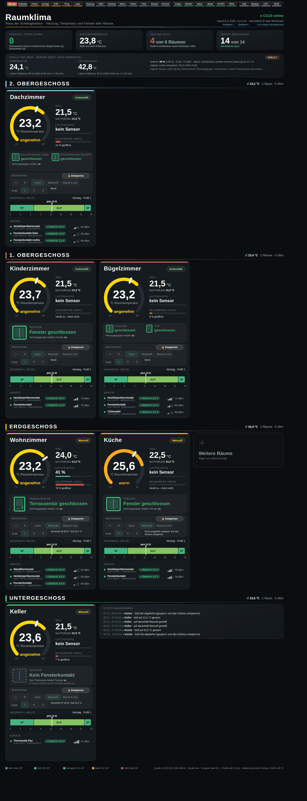
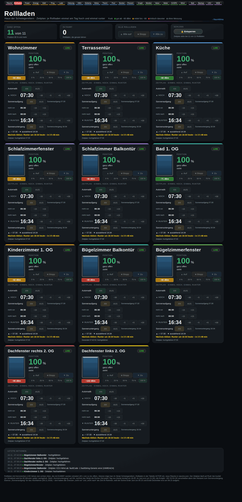
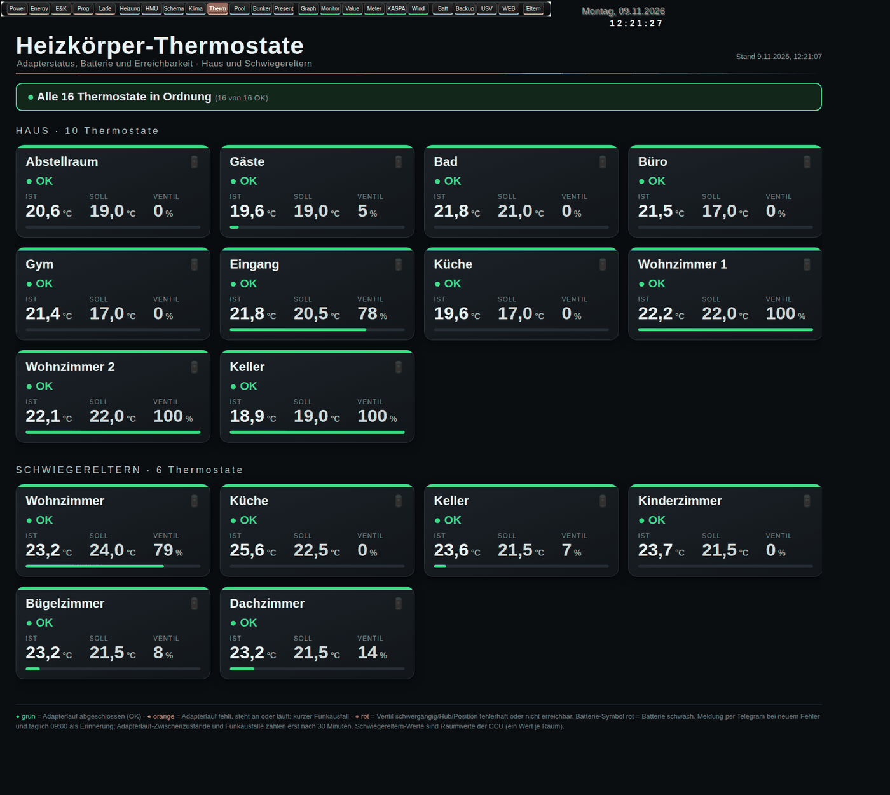
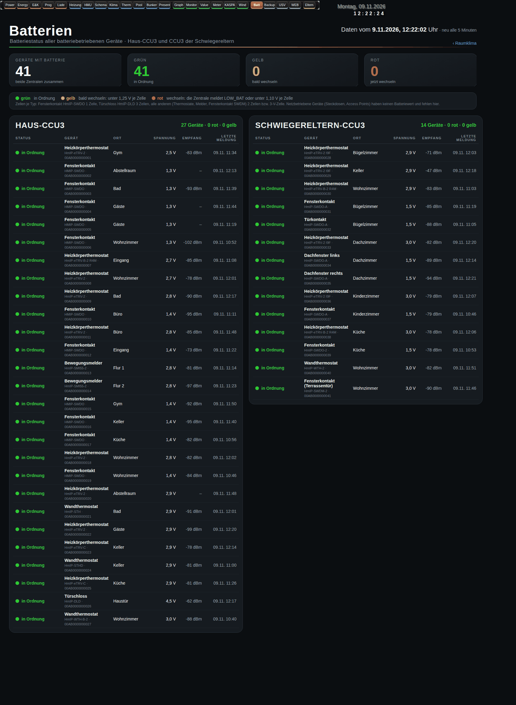

# Heizung, Rollladen, Thermostat-Wächter und Batterie-Ampel für ioBroker + HomeMatic IP

Ein kleines, im Alltag erprobtes Paket für **ioBroker** (Javascript-Adapter, vis-2) mit einer **CCU3 / RaspberryMatic**.
Es wurde für das Haus einer Familie gebaut und dort 2026 in Betrieb genommen. Alles ist **Deutsch** dokumentiert.

> Ohne Gewähr. Es schaltet echte Heizkörper und Rollläden. Erst lesend einsetzen (Schloss in der View lassen),
> dann einzeln testen. Gerätenummern, IP-Adressen und Chat-IDs in diesem Repository sind **Platzhalter**.

## Was ist drin

| Teil | Skript | View | Zweck |
|---|---|---|---|
| **Heizung** | `skripte/heizung_ccu.js`, `skripte/heizung_karten.js` | `views/heizung_raeume.json` | Räume nach Geschossen: Ist/Soll, Ventil, Fenster, Profil-Verlauf, Soll ± 0,5 °C, Auto/Manuell, Boost, Profil 1–3 |
| **Rollladen** | `skripte/rollladen_zeitplan.js` | `views/rollladen.json` | je Raum **einmal hoch, einmal runter** pro Tag — feste Uhrzeit **oder gekoppelt an Sonnenauf-/untergang** (mit Grenzen), dazu ein **Notlauf in der CCU** für den Fall, dass ioBroker ausfällt |
| **Thermostat-Wächter** | `skripte/thermostat_waechter.js` | `views/thermostate.json` | meldet Ventilfehler, schwache Batterie, nicht erreichbar per Telegram und als Banner |
| **Batterie-Ampel** | `skripte/batterien_uebersicht.js` | `views/batterie.json` | rot/gelb/grün je Gerät, Schwelle **je Zelle** (nicht je Gerät) |

**Weiterführend:**
* [`docs/PROGRAMMLOGIK.md`](docs/PROGRAMMLOGIK.md) – die Programmlogik jedes Skripts im Detail (Abläufe, Algorithmen, Zeitsteuerung, Datenpunkte)
* [`docs/CLAUDE-CODE-ANLEITUNG.md`](docs/CLAUDE-CODE-ANLEITUNG.md) – Schritt-für-Schritt-Anleitung, mit der **Claude Code** (oder ein anderer Agent) dieses Repository in ein ioBroker einbaut
* [`CLAUDE.md`](CLAUDE.md) – Einstieg für Claude Code (wird automatisch gelesen)

## Bilder






## So funktioniert es

```
Heizkörper-Thermostate, Fensterkontakte, Rollladenaktoren (HmIP)
        │  Funk
     CCU3 / RaspberryMatic ── XML-RPC Port 2010 (Geräte) ── Port 9292 /groups (Heizgruppen)
        │
   ioBroker  (Skript heizung_ccu.js liest und schreibt DIREKT an der CCU, nicht über hm-rpc)
        │  Datenpunkte unter 0_userdata.0.<Projekt>.*
   heizung_karten.js  → rendert pro Widget fertiges HTML (siehe „Ladezeit“)
        │
   vis-2 View
```

* **Lesen/Schreiben direkt an der CCU.** Für Heizgruppen braucht man Port 9292, den der normale `hm-rpc`-Adapter nicht anbietet.
  Die Firewall der CCU muss XML-RPC für ioBroker freigeben („eingeschränkt“, nicht „offen“).
* **Bedienung abgesichert:** Die View hat keine Anmeldung. Deshalb gibt es ein **Schloss** (10 s Entsperrung), Grenzen **8–26 °C**,
  höchstens **20 Befehle in 10 Minuten je Raum** und einen Gesamtschalter `Bedienung_erlaubt`. Nach jedem Skriptstart ist alles gesperrt.
* **Rollladen:** Der Zeitplan läuft **in ioBroker**, nicht in der CCU. Fällt ioBroker zur Schaltzeit nur kurz aus, wird innerhalb
  von 60 Minuten nachgeholt — ebenso, wenn die CCU einen Fahrbefehl wegen schwachem Funk ablehnt (`UNREACH`): dann wird
  im selben Fenster alle 5 Minuten erneut versucht, statt die Fahrt für den Tag abzuhaken. Fällt er **länger** aus — oder reißt die Netzverbindung zur CCU ab — übernimmt der
  **[Notlauf in der CCU](notlauf/)**: Bleibt das Lebenszeichen über 30 Minuten aus, fährt die Zentrale selbst, geprüft alle
  15 Minuten, Fahrten bis 90 Minuten nach der Sollzeit. Er ist **zustandslos** — er sieht die Position des Aktors an, statt
  sich zu merken, ob heute schon gefahren wurde.
* **Sonnenzeiten:** Hoch- und Runter-Zeit lassen sich je Raum an Sonnenauf- und ‑untergang koppeln (Quelle: Adapter
  `followthesun`, Versatz je Raum einstellbar). Beim **Hochfahren** begrenzen zwei Schranken das Ergebnis (voreingestellt
  06:30–08:00), sonst risse der Rollladen Ende Juni um 05:15 auf. Berechnet wird nur `<Richtung>_Min` — Zeitplan, Anzeige
  und Notlauf-Plan lesen unverändert diesen einen Wert.

> **Hinweis zu `views/`:** Die JSON-Dateien sind Exporte der laufenden Views (mit Karten-Bindungen). `views/heizung_raeume.json` enthält zusätzlich einen
> Shelly-Sensorblock, dessen Skript nicht Teil des Pakets ist. Für den eigenen Einbau besser die **Generator-Ausgabe** (`generatoren/ausgabe/vis-views.json`) verwenden.

## Einrichtung (Kurzfassung)

1. Im Skript `heizung_ccu.js` oben die Konfiguration anpassen: CCU-Adresse (`192.168.1.10` ist ein Platzhalter), Räume,
   Heizgruppen (`INT…`), Thermostat- und Fensterkontakt-Adressen (`00AB…` sind Platzhalter).
   Die Gruppen-Mitglieder stehen in `/usr/local/etc/config/groups.gson` der CCU.
2. Skript in ioBroker anlegen und starten. Es erzeugt die Datenpunkte selbst.
3. `heizung_karten.js` anlegen (rendert die View-Bindungen). Danach `views/heizung_raeume.json` in das vis-2-Projekt einspielen
   (**nie** mit `cp` in das Projektverzeichnis kopieren, sondern `iobroker file write`).
4. Rollladen: `rollladen_zeitplan.js` und `views/rollladen.json` genauso; Aktorkanäle und Räume oben im Skript eintragen.
5. Thermostat-Wächter: in `thermostat_waechter.js` die Thermostatliste und `TELEGRAM_CHATS` eintragen (Adapter `telegram.0` nötig).
6. Batterie-Ampel: `batterien_uebersicht.js` (Geräte und Zellenzahl je Typ stehen oben im Skript).

## Gelerntes (Fallen, die Zeit gekostet haben)

* **„Auto“-Knopf aus `CONTROL_MODE` ableiten ist falsch.** Heizgruppen melden `CONTROL_MODE` nicht; es bleibt 0, der Knopf leuchtet immer grün.
  Richtig: `Boost → 3`, `SET_POINT_MODE == 0 → 0 (Auto)`, sonst `1 (Manuell)`.
* **Ladezeit der View:** vis-2 wertet alle Bindungen bei jedem Wert neu aus. Mehr als etwa **15 Bindungen je Widget** machen die View
  extrem langsam (75 s statt 6 s). Lösung: `heizung_karten.js` rendert pro Widget das fertige HTML in **einen** Datenpunkt.
* **Fenster-offen:** Ein Thermostat senkt bei geöffnetem Fenster auf die Fenster-offen-Temperatur und stellt danach den **vorigen Wert** wieder her.
  Stand es vorher auf Manuell, bleibt es auf Manuell – das Wochenprofil greift erst nach „Auto“.
* **Funkschwacher Wandthermostat** kann „Fenster offen“ in der Gruppe festhalten und die ganze Gruppe absenken.
  Prüfreihenfolge: Soll gegen Profil, `WINDOW_STATE` der Gruppe, `UNREACH` der Mitglieder.
* **Batterie nach Zellen bewerten:** gelb unter 1,25 V je Zelle, rot unter 1,1 V; Fensterkontakt SWDO 1 Zelle, Türschloss DLD 3, sonst 2.
* **CCU-Programme statt Direktverknüpfung** für „Licht aus nach x Sekunden“: `ON_TIME` bei einer Sensor-Verknüpfung ist nur einmalig wirksam.
* **ReGa-Skript:** verkettete Methodenaufrufe in einer Zeile lassen das ganze Skript kommentarlos scheitern. Erst Variable, dann Aufruf.
* **ReGa rechnet ohne Punkt-vor-Strich.** `h * 60 + m` ergibt `h * (60 + m)`. Jede Multiplikation klammern.
* **Ein Wächter ohne Lebenszeichen ist schlechter als keiner.** Der Notlauf schrieb anfangs nur bei einer Ersatzfahrt.
  Eine Woche lang sah es aus, als liefe er nicht — tatsächlich lief er, hatte nur nichts zu melden. Jetzt schreibt er bei
  **jedem** Lauf einen Zeitstempel. Und: nach dem Ändern einer `.rega`-Datei prüfen, was wirklich **in der CCU** steht.
* **Zeitsteuerung in der CCU hat zwei Felder.** Das Intervall (`period`) allein genügt nicht — es gibt zusätzlich eine
  Zeitspanne (`calduration`). Stand sie auf 30 Minuten, lief ein „alle 15 Minuten“-Programm nur zweimal am Tag, ohne dass
  man es der Programmliste ansah. Für ganztägig: `calduration` 86400 und `time` 00:00.
* **vis-2: ein zu kleines Widget schneidet nichts ab — es nimmt den Scrollweg.** Die Elternkette hat `overflow: visible`,
  der Inhalt wird also gezeichnet, aber der scrollbare Bereich richtet sich nach dem Widget. Ergebnis: sichtbar wäre es,
  hinkommen kann man nicht. Prüfen mit `document.documentElement.scrollHeight - window.innerHeight` gegen die unterste
  Elementkante, nicht durch Nachrechnen der Container-Höhe.
* **Neue Bedienelemente an den vorhandenen messen, nicht an der freien Fläche** — in beiden Richtungen. Zwei neu
  eingefügte Knöpfe waren 42 px breit mit 2 px Abstand, während alle anderen der View 58–106 px mit 4–6 px hatten; nach der
  Korrektur lagen die Zeilen senkrecht 2 px auseinander. Faustregel: Zeilenabstand = Knopfhöhe + 10 px.

## Zeitsteuerung (Cron)

Es wird **kein Cron-Eintrag auf dem Betriebssystem** gebraucht. Alle Takte laufen im ioBroker-Javascript-Adapter (`schedule(...)`, `setInterval`):
Heizung jede Minute (Werte), alle 30 s (Geräte), alle 10 Minuten (Wochenprofile); Rollladen jede Sekunde (Position) und alle 20 s (Zeitplan);
Batterien alle 5 Minuten; Thermostat-Wächter alle 5 Minuten plus täglich 09:00 (Erinnerung). Details in `docs/PROGRAMMLOGIK.md`, Abschnitt 7.
Nur die **Zeitzone** des Rechners muss stimmen.

## Generatoren

**Ein Aufruf baut alles:** `cd generatoren && python3 bauen.py` → `generatoren/ausgabe/` (View-Projekt, Karten-, Rollladen- und Batterie-Skript, Batterie-View).
`generatoren/view_einfuegen.py` fügt eine View in ein vorhandenes vis-2-Projekt ein. Einzelheiten:

`generatoren/heizung/build_schwiegereltern.py` erzeugt aus einer Raumliste die View; `build_karten.py` macht aus der View die
Vorlagen für `heizung_karten.js`; `sw_nav.py` baut die Navigationsleiste; `deploy_raeume.py` spielt ein (sichert vorher);
`cdp_steps.py` macht Screenshots der echten View per Headless-Chrome (nötig, weil `--screenshot` nur den Ladekreis zeigt – 14 s warten).
Die Pfade in den Generatoren sind Beispiele und müssen angepasst werden.

`generatoren/rollladen/build_view.py` erzeugt die Rollladen-View, `build_script.py` das Zeitplan-Skript aus `vorlage.js`
und `raeume.json`.

## Notlauf in der CCU

`notlauf/` enthält die Absicherung für den Fall, dass ioBroker oder die Netzverbindung ausfällt:

* [`notlauf/notlauf.rega`](notlauf/notlauf.rega) – das ReGa-Skript, das in der CCU läuft
* [`notlauf/ANLEITUNG.md`](notlauf/ANLEITUNG.md) – wie man das Programm in der CCU anlegt und prüft, ob es arbeitet
* [`notlauf/NOTFALL-VERBINDUNG.md`](notlauf/NOTFALL-VERBINDUNG.md) – **Notfallblatt für Laien:** was bei einem Ausfall
  der Verbindung mit Heizung und Rollläden passiert, was man tun muss und was nach der Rückkehr zu prüfen ist

## Lizenz

MIT, siehe `LICENSE`.
