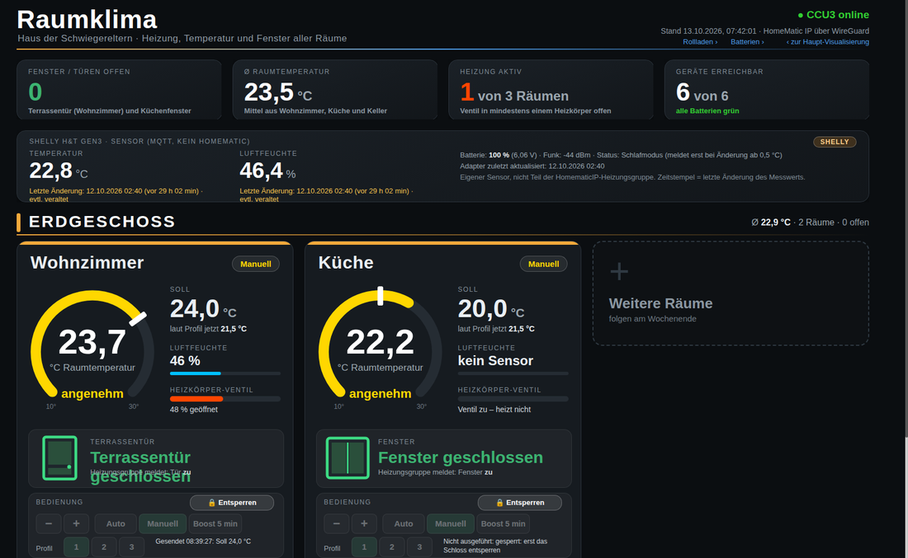
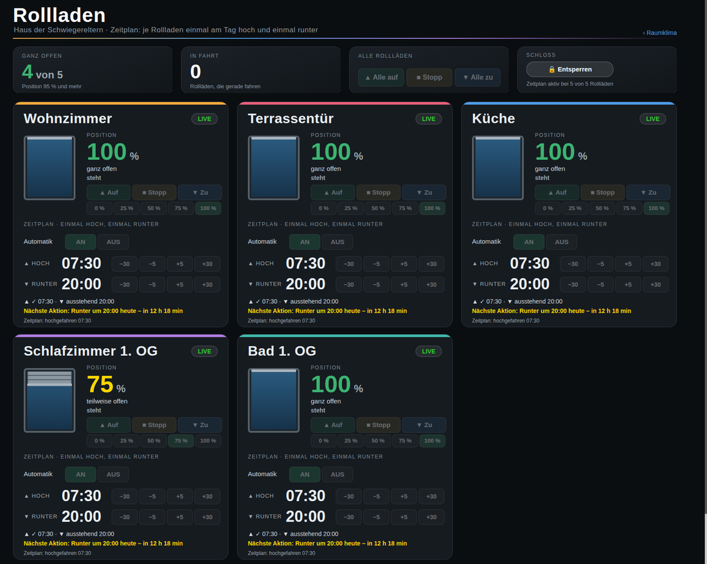
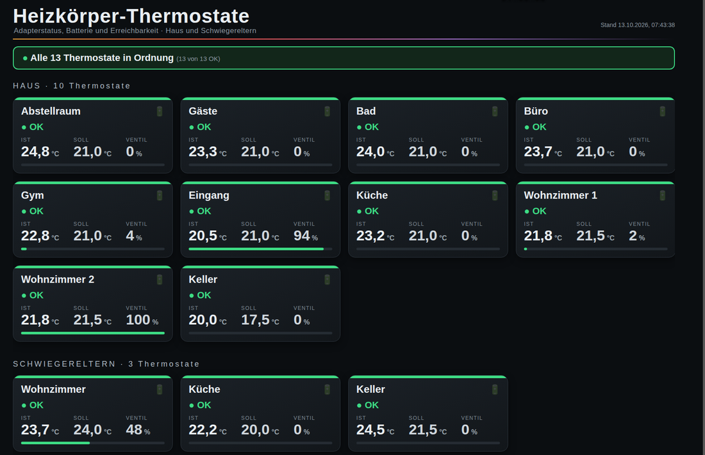
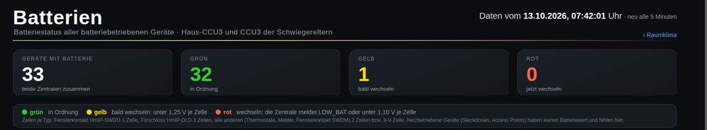

# Heizung, Rollladen, Thermostat-Wächter und Batterie-Ampel für ioBroker + HomeMatic IP

Ein kleines, im Alltag erprobtes Paket für **ioBroker** (Javascript-Adapter, vis-2) mit einer **CCU3 / RaspberryMatic**.
Es wurde für das Haus einer Familie gebaut und dort 2026 in Betrieb genommen. Alles ist **Deutsch** dokumentiert.

> Ohne Gewähr. Es schaltet echte Heizkörper und Rollläden. Erst lesend einsetzen (Schloss in der View lassen),
> dann einzeln testen. Gerätenummern, IP-Adressen und Chat-IDs in diesem Repository sind **Platzhalter**.

## Was ist drin

| Teil | Skript | View | Zweck |
|---|---|---|---|
| **Heizung** | `skripte/heizung_ccu.js`, `skripte/heizung_karten.js` | `views/heizung_raeume.json` | Räume nach Geschossen: Ist/Soll, Ventil, Fenster, Profil-Verlauf, Soll ± 0,5 °C, Auto/Manuell, Boost, Profil 1–3 |
| **Rollladen** | `skripte/rollladen_zeitplan.js` | `views/rollladen.json` | je Raum **einmal hoch, einmal runter** pro Tag, Uhrzeit einstellbar, Maximalgrenze je Raum |
| **Thermostat-Wächter** | `skripte/thermostat_waechter.js` | `views/thermostate.json` | meldet Ventilfehler, schwache Batterie, nicht erreichbar per Telegram und als Banner |
| **Batterie-Ampel** | `skripte/batterien_uebersicht.js` | `views/batterie.json` | rot/gelb/grün je Gerät, Schwelle **je Zelle** (nicht je Gerät) |

Die Ordner `generatoren/` enthalten die Python-Skripte, die View und Karten-Skript erzeugen (siehe unten).

## Bilder






## So funktioniert es

```
Heizkörper-Thermostate, Fensterkontakte, Rollladenaktoren (HmIP)
        │  Funk
     CCU3 / RaspberryMatic ── XML-RPC Port 2010 (Geräte) ── Port 9292 /groups (Heizgruppen)
        │
   ioBroker  (Skript heizung_ccu.js liest und schreibt DIREKT an der CCU, nicht über hm-rpc)
        │  Datenpunkte unter 0_userdata.0.<Projekt>.*
   heizung_karten.js  → rendert pro Widget fertiges HTML (siehe „Ladezeit“)
        │
   vis-2 View
```

* **Lesen/Schreiben direkt an der CCU.** Für Heizgruppen braucht man Port 9292, den der normale `hm-rpc`-Adapter nicht anbietet.
  Die Firewall der CCU muss XML-RPC für ioBroker freigeben („eingeschränkt“, nicht „offen“).
* **Bedienung abgesichert:** Die View hat keine Anmeldung. Deshalb gibt es ein **Schloss** (10 s Entsperrung), Grenzen **8–26 °C**,
  höchstens **20 Befehle in 10 Minuten je Raum** und einen Gesamtschalter `Bedienung_erlaubt`. Nach jedem Skriptstart ist alles gesperrt.
* **Rollladen:** Der Zeitplan läuft **in ioBroker**, nicht in der CCU. Fällt ioBroker zur Schaltzeit aus, wird innerhalb von 60 Minuten nachgeholt.

## Einrichtung (Kurzfassung)

1. Im Skript `heizung_ccu.js` oben die Konfiguration anpassen: CCU-Adresse (`192.168.1.10` ist ein Platzhalter), Räume,
   Heizgruppen (`INT…`), Thermostat- und Fensterkontakt-Adressen (`00AB…` sind Platzhalter).
   Die Gruppen-Mitglieder stehen in `/usr/local/etc/config/groups.gson` der CCU.
2. Skript in ioBroker anlegen und starten. Es erzeugt die Datenpunkte selbst.
3. `heizung_karten.js` anlegen (rendert die View-Bindungen). Danach `views/heizung_raeume.json` in das vis-2-Projekt einspielen
   (**nie** mit `cp` in das Projektverzeichnis kopieren, sondern `iobroker file write`).
4. Rollladen: `rollladen_zeitplan.js` und `views/rollladen.json` genauso; Aktorkanäle und Räume oben im Skript eintragen.
5. Thermostat-Wächter: in `thermostat_waechter.js` die Thermostatliste und `TELEGRAM_CHATS` eintragen (Adapter `telegram.0` nötig).
6. Batterie-Ampel: `batterien_uebersicht.js` (Geräte und Zellenzahl je Typ stehen oben im Skript).

## Gelerntes (Fallen, die Zeit gekostet haben)

* **„Auto“-Knopf aus `CONTROL_MODE` ableiten ist falsch.** Heizgruppen melden `CONTROL_MODE` nicht; es bleibt 0, der Knopf leuchtet immer grün.
  Richtig: `Boost → 3`, `SET_POINT_MODE == 0 → 0 (Auto)`, sonst `1 (Manuell)`.
* **Ladezeit der View:** vis-2 wertet alle Bindungen bei jedem Wert neu aus. Mehr als etwa **15 Bindungen je Widget** machen die View
  extrem langsam (75 s statt 6 s). Lösung: `heizung_karten.js` rendert pro Widget das fertige HTML in **einen** Datenpunkt.
* **Fenster-offen:** Ein Thermostat senkt bei geöffnetem Fenster auf die Fenster-offen-Temperatur und stellt danach den **vorigen Wert** wieder her.
  Stand es vorher auf Manuell, bleibt es auf Manuell – das Wochenprofil greift erst nach „Auto“.
* **Funkschwacher Wandthermostat** kann „Fenster offen“ in der Gruppe festhalten und die ganze Gruppe absenken.
  Prüfreihenfolge: Soll gegen Profil, `WINDOW_STATE` der Gruppe, `UNREACH` der Mitglieder.
* **Batterie nach Zellen bewerten:** gelb unter 1,25 V je Zelle, rot unter 1,1 V; Fensterkontakt SWDO 1 Zelle, Türschloss DLD 3, sonst 2.
* **CCU-Programme statt Direktverknüpfung** für „Licht aus nach x Sekunden“: `ON_TIME` bei einer Sensor-Verknüpfung ist nur einmalig wirksam.
* **ReGa-Skript:** verkettete Methodenaufrufe in einer Zeile lassen das ganze Skript kommentarlos scheitern. Erst Variable, dann Aufruf.

## Generatoren

`generatoren/heizung/build_schwiegereltern.py` erzeugt aus einer Raumliste die View; `build_karten.py` macht aus der View die
Vorlagen für `heizung_karten.js`; `sw_nav.py` baut die Navigationsleiste; `deploy_raeume.py` spielt ein (sichert vorher);
`cdp_steps.py` macht Screenshots der echten View per Headless-Chrome (nötig, weil `--screenshot` nur den Ladekreis zeigt – 14 s warten).
Die Pfade in den Generatoren sind Beispiele und müssen angepasst werden.

## Lizenz

MIT, siehe `LICENSE`.
